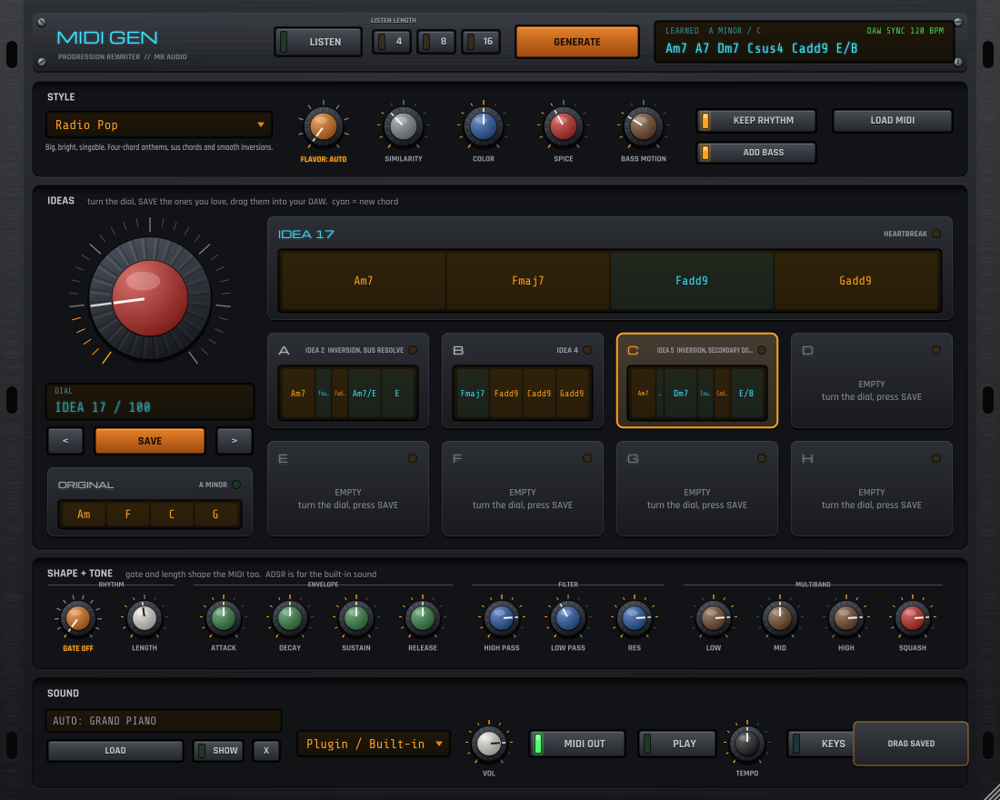

# MIDI GEN — Free Progression Rewriter by MB Audio

MIDI GEN learns the chord progression on your track, then you **turn the IDEA dial**: every click is a new progression in the same key and the same rhythm, playing straight away, locked to your DAW. Hear one you love? Press **SAVE**, then keep turning. Drag your saved ideas into your DAW, or play them live from your keyboard with **KEYS** mode.



## Download (free)

Click the zip for your computer to download it (or see **[all releases](https://github.com/Maxswell5412/MIDI-GEN-VST/releases/latest)**):

| Computer | File | Formats |
|---|---|---|
| Mac (Apple Silicon + Intel) | **[⬇ MIDIGEN-Mac.zip](https://github.com/Maxswell5412/MIDI-GEN-VST/releases/latest/download/MIDIGEN-Mac.zip)** | AU + VST3 |
| Windows (64-bit) | **[⬇ MIDIGEN-Windows.zip](https://github.com/Maxswell5412/MIDI-GEN-VST/releases/latest/download/MIDIGEN-Windows.zip)** | VST3 |
| Linux (64-bit) | **[⬇ MIDIGEN-Linux.zip](https://github.com/Maxswell5412/MIDI-GEN-VST/releases/latest/download/MIDIGEN-Linux.zip)** | VST3 + standalone app |

Each zip has a short **Install** text inside. Works in Ableton Live, FL Studio, Logic Pro (AU), Bitwig, REAPER and more.

## Free forever, support the culture

MIDI GEN is free, with no trial, no sign-up and nothing locked. Use it on anything you make, including commercial releases.
If it helps your music and you want to keep new plugins coming, hit the **Sponsor** button at the top of this page. Any amount helps.

## Build it yourself

```
cmake -B build -DCMAKE_BUILD_TYPE=Release
cmake --build build -j8
```
Needs CMake 3.22+ and a C++17 compiler (Xcode on Mac, Visual Studio 2022 on Windows, GCC/Clang on Linux; Linux also needs the ALSA/X11/FreeType dev packages listed in `.github/workflows/build.yml`). JUCE downloads automatically.


## New in v0.2
- **IDEA dial + SAVE:** 100 ideas per dial; SAVE keeps the ones you like in slots A–H (right-click a slot to clear it). GENERATE gives you a fresh set of 100.
- **Chords like HOOKSMITH v0.4:** the full HOOKSMITH progression bank, rich colours (9ths, 11ths, 13ths, 6/9, 7#9, 7b9, maj7#11, sus2 7ths, slash chords), wide "melodic chord" voicings, and colours checked against the key.
- **FLAVOR knob:** Auto, Soul Keys, West Coast, Dance Kiss, Neo Gold, Dark Trap, Gospel Lift, Cinema, Lo-Fi Jazz. Each one pulls different chords in the same key.
- **14 new styles:** Gangsta Rap (G-Funk), Boom Bap, House Rap, EDM / Big Room, Future Bass, Melodic Trap, Drill, Lo-Fi Hip Hop, Gospel, Reggaeton / Latin, 90s R&B, Trance, Phonk, Country.
- **KEYS mode:** your MIDI keyboard plays the chords, like Cthulhu. White keys from C3 = chord 1, 2, 3... Hold a key and the chord holds.
- **SHAPE + TONE:** GATE (rhythmic chops locked to the DAW), LENGTH, ADSR for the built-in sound, HIGH PASS / LOW PASS with resonance, and a 3-band MULTIBAND with SQUASH compression.
- **Tight playback:** chords ring right up to the next hit (no gaps), turning the dial or clicking a slot re-strikes the chord at once, and it follows the DAW's clock and tempo ("DAW SYNC" on the screen).
- **Console look:** Neve-style knobs with SSL colour caps and console keys.

## The workflow
1. Drag a chord clip onto a MIDI track. A [HOOKSMITH](https://github.com/Maxswell5412/HOOKSMITH-VST) **Chords** clip is perfect, and so is your own idea or a chord MIDI file from a pack.
2. Put **MIDI GEN** on the same track.
3. Set **LISTEN LENGTH** to the clip length (4, 8 or 16 bars), press **LISTEN**, then play the clip from bar 1. MIDI GEN learns the key and the chords. You can also click **LOAD MIDI**, or drag a .mid file onto it.
4. Pick a **STYLE** and a **FLAVOR**, press play in your DAW and **turn the IDEA dial** (or use **<** and **>**).
5. Hear one you love? **SAVE** it. Keep turning, keep saving (up to 8).
6. Click a saved slot to hear it again. Drag a slot (or the dial's idea) into your DAW, or **DRAG SAVED** to drop all your saved ideas back to back.
7. Want to perform it? Turn on **KEYS** and play the chords from your keyboard while you record.

## Styles
Radio Pop, Moody Rap (OVO), Dark Trap, Soul Ballad, House / Deep House, Afro / Amapiano, Neo-Soul / R&B, Cinematic Pop, Gangsta Rap (G-Funk), Boom Bap, House Rap, EDM / Big Room, Future Bass, Melodic Trap, Drill (UK / NY), Lo-Fi Hip Hop, Gospel, Reggaeton / Latin, 90s R&B, Trance, Phonk, Country.

The styles and flavors are written from the harmony these genres use. They don't copy any song.

## Knobs
- **FLAVOR**: the kind of chords the ideas reach for, all in the same key.
- **SIMILARITY**: turned right, it keeps your chords and only recolours them. Turned left, all-new chords.
- **COLOR**: plain triads to lush 7ths, 9ths, 11ths and 13ths.
- **SPICE**: passing diminished chords, secondary dominants, sus resolutions, tritone subs, borrowed iv.
- **BASS MOTION**: inversions for a walking bass line, and pedal bass.
- **KEEP RHYTHM**: the new chords hit where your clip hit. Off = held chords.
- **ADD BASS**: a low bass note under each chord, with the chord spread wide above it.
- **GATE / LENGTH**: chop the chords into a rhythm and set how long each hit rings (also in the dragged MIDI).
- **ATTACK / DECAY / SUSTAIN / RELEASE**: shape the built-in sound (middle = as designed).
- **HIGH PASS / LOW PASS / RES** and **MULTIBAND LOW / MID / HIGH / SQUASH**: shape the sound of the built-in keys or your plugin.

## Sound
**LOAD** an instrument (VST3/AU), or use the built-in sounds (click the display to choose). **MIDI OUT** sends the chords out too. Everything (the learned clip, your saved slots and your instrument) is saved with your project.

## Files
`Source/Reharm.*` is the reharmonizer (styles, substitutions, voicing). `Source/PluginProcessor.*` handles listen/learn, playback, hosting and export. `Source/PluginEditor.*` is the interface. `Tests/` contains the automated tests.

## Licence
Free and open source under the **GNU AGPLv3** (see `LICENSE`), built with [JUCE](https://juce.com). The music you make with MIDI GEN is 100% yours.
